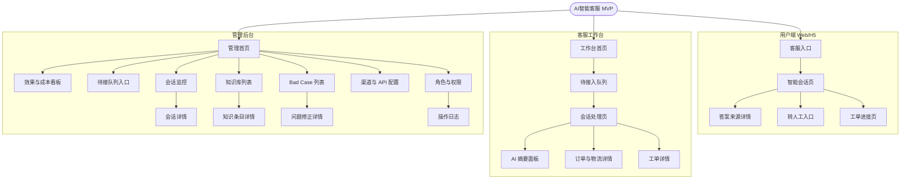
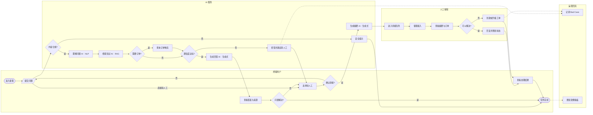

# AI智能客服产品架构设计

**范围：** MVP 首版，仅包含用户研究与需求清单中确定的 12 条 P0 需求。  
**产品定位：** 可解释、可接管、可闭环的 AI 客服。  
**本阶段交付：** 产品功能架构图、信息架构图、核心用户流程图；暂不包含页面原型。

## 一、产品功能架构图

figma链接：[https\://www.figma.com/board/VIL0tz64G3cQeYmprZjDkt/AI%E6%99%BA%E8%83%BD%E5%AE%A2%E6%9C%8DMVP%EF%BD%9C%E4%BA%A7%E5%93%81%E5%8A%9F%E8%83%BD%E6%9E%B6%E6%9E%84%E5%9B%BE?node-id=0-1\&t=m5jFKJ8ZwyQPf77i-1](https://www.figma.com/board/VIL0tz64G3cQeYmprZjDkt/AI%E6%99%BA%E8%83%BD%E5%AE%A2%E6%9C%8DMVP%EF%BD%9C%E4%BA%A7%E5%93%81%E5%8A%9F%E8%83%BD%E6%9E%B6%E6%9E%84%E5%9B%BE?node-id=0-1&t=m5jFKJ8ZwyQPf77i-1)

```mermaid
flowchart TD
    product(["AI智能客服 MVP"])

    subgraph customer ["用户端"]
        customerHub[Web/H5 客服]
        smartQa["智能问答 AI：NLP + RAG + 生成"]
        answerSource[答案来源与更新时间]
        humanEntry[一键转人工]
        ticketTrack[工单状态查询]
        customerHub --> smartQa
        customerHub --> answerSource
        customerHub --> humanEntry
        customerHub --> ticketTrack
    end

    subgraph agent ["客服工作台"]
        agentHub[会话工作台]
        queue[待接入队列]
        aiSummary["会话摘要 AI：生成式摘要"]
        orderPanel[订单与物流查询]
        ticketAction[工单创建与更新]
        liveTakeover[实时接管]
        agentHub --> queue
        agentHub --> aiSummary
        agentHub --> orderPanel
        agentHub --> ticketAction
        agentHub --> liveTakeover
    end

    subgraph admin ["管理后台"]
        adminHub[运营管理]
        knowledge[知识库批量导入]
        adminQueue[待接队列入口]
        monitor[会话监控与异常告警]
        badCase[Bad Case 收件箱]
        metrics[效果与成本看板]
        permission[角色权限与审计]
        adminHub --> knowledge
        adminHub --> adminQueue
        adminHub --> monitor
        adminHub --> badCase
        adminHub --> metrics
        adminHub --> permission
    end

    subgraph ai ["AI 引擎"]
        aiHub[可信问答引擎]
        parse["问题理解 AI：NLP"]
        retrieve["知识检索 AI：RAG"]
        generate["回答生成 AI：生成式"]
        confidence["置信度判断 AI：分类"]
        summarize["上下文摘要 AI：生成式"]
        aiHub --> parse
        aiHub --> retrieve
        aiHub --> generate
        aiHub --> confidence
        aiHub --> summarize
    end

    subgraph integration ["业务集成"]
        integrationHub[集成层]
        channelApi[Web/H5 与基础 API]
        orderApi[订单与物流系统]
        ticketApi[工单系统]
        integrationHub --> channelApi
        integrationHub --> orderApi
        integrationHub --> ticketApi
    end

    subgraph security ["数据与安全"]
        securityHub[安全底座]
        rbac[RBAC 权限]
        masking[敏感字段遮蔽]
        audit[操作日志]
        securityHub --> rbac
        securityHub --> masking
        securityHub --> audit
    end

    product --> customerHub
    product --> agentHub
    product --> adminHub
    product --> aiHub
    product --> integrationHub
    product --> securityHub
```

### AI 能力说明

| AI 能力 | 类型     | MVP 中的作用                   |
| ----- | ------ | -------------------------- |
| 问题理解  | NLP    | 理解用户问题与关键实体，为检索和业务查询提供输入   |
| 知识检索  | RAG    | 从企业知识库检索相关条目，降低脱离业务知识回答的风险 |
| 回答生成  | 生成式 AI | 基于检索结果组织自然语言答案，并关联来源和更新时间  |
| 置信度判断 | 分类/评分  | 判断是否可以直接回答，低置信度时拒答并建议转人工   |
| 上下文摘要 | 生成式 AI | 转人工时提炼用户诉求、已确认信息和历史动作      |

## 二、信息架构图

figma链接：[https\://www.figma.com/board/hZbNO0tSCd1LeccbCMy5WT/AI%E6%99%BA%E8%83%BD%E5%AE%A2%E6%9C%8DMVP%EF%BD%9C%E4%BF%A1%E6%81%AF%E6%9E%B6%E6%9E%84%E5%9B%BE%EF%BC%88%E4%BF%AE%E6%AD%A3%E7%89%88%EF%BC%89?node-id=0-1\&t=Q7GZS72jDVCvrifW-1](https://www.figma.com/board/hZbNO0tSCd1LeccbCMy5WT/AI%E6%99%BA%E8%83%BD%E5%AE%A2%E6%9C%8DMVP%EF%BD%9C%E4%BF%A1%E6%81%AF%E6%9E%B6%E6%9E%84%E5%9B%BE%EF%BC%88%E4%BF%AE%E6%AD%A3%E7%89%88%EF%BC%89?node-id=0-1&t=Q7GZS72jDVCvrifW-1)

## 三、核心用户流程图

**核心任务：** 终端用户通过 Web/H5 客服完成问题咨询；AI 无法可靠解决时无缝转人工，并通过订单或工单形成处理闭环。

figma链接：[https\://www.figma.com/board/KqDC7W5GRmjJiTgLZdtHmq/AI%E6%99%BA%E8%83%BD%E5%AE%A2%E6%9C%8DMVP%EF%BD%9C%E6%A0%B8%E5%BF%83%E7%94%A8%E6%88%B7%E6%B5%81%E7%A8%8B%E5%9B%BE?node-id=0-1\&t=av0EpQEsaJnxCPal-1](https://www.figma.com/board/KqDC7W5GRmjJiTgLZdtHmq/AI%E6%99%BA%E8%83%BD%E5%AE%A2%E6%9C%8DMVP%EF%BD%9C%E6%A0%B8%E5%BF%83%E7%94%A8%E6%88%B7%E6%B5%81%E7%A8%8B%E5%9B%BE?node-id=0-1&t=av0EpQEsaJnxCPal-1)

## 四、架构边界

* 首版渠道只覆盖 Web/H5 和基础 API，不包含电话、视频及微信全生态。

* AI 只承担理解、检索、生成、分类判断和摘要，不自动执行退款、改地址等高风险写操作。

* 人工可随时接管；低置信度必须拒答或转人工，不能强行生成答案。

* 用户确认转人工后仅在后端创建待接项，用户端保留等待状态；待接队列仅由客服或管理员从工作台/管理后台入口访问并选择会话接入。

* 业务闭环覆盖订单与物流查询、工单创建、状态更新和结果回传。

* 管理后台围绕知识维护、实时监控、Bad Case、权限审计和效果看板展开，不做复杂自定义 BI。

